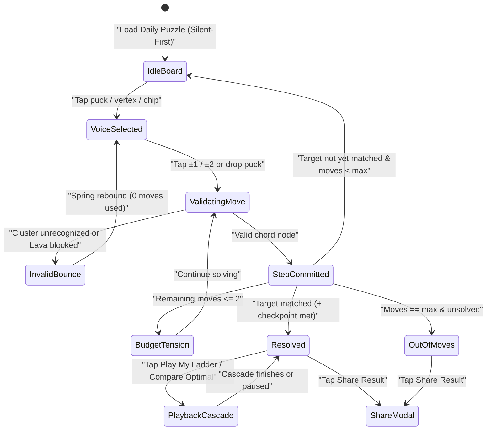

# STEPWISE — Claude Code Engineering Handoff Contract

> **Purpose:** Complete design-to-engineering integration contract enabling Claude Code to drop in the 52/84-node chord graph, BFS/Dijkstra Par solver, deterministic UTC daily PRNG, `localStorage` stats/streak store, and Web Audio / `Tone.js` Rhodes synth with **zero visual drift**.

---

## 1. Complete Deliverable & Asset Inventory

```text
StepWise/
├── assets/
│   ├── brand/
│   │   ├── logo.svg                        # Architectural horizontal lockup (uses currentColor text)
│   │   ├── favicon.svg                     # 64x64 anodized 3-channel browser icon
│   │   ├── apple-touch-icon.png            # 512x512 full-bleed dark slate app icon
│   │   └── og-image.png                    # 1200x630 Swiss editorial Open Graph card
│   ├── medals/
│   │   ├── medal-frame.svg                 # Neutral circular 12-tick bezel SVG overlay
│   │   ├── frame-eagle.svg                 # Gold-accented 12-tick Eagle bezel
│   │   ├── frame-par.svg                   # Emerald-accented 12-tick Par bezel
│   │   ├── frame-solved.svg                # Cobalt-accented Solved bezel
│   │   ├── frame-challenge.svg             # Vermilion/Orchid dashed challenge bezel
│   │   ├── medal-eagle.png                 # 512x512 transparent-bg machined Eagle medal
│   │   ├── medal-par-pure.png              # 512x512 transparent-bg Platinum/Emerald medal
│   │   ├── medal-par.png                   # 512x512 transparent-bg Titanium/Emerald golf medal
│   │   ├── medal-solved.png                # 512x512 transparent-bg Aluminum/Cobalt medal
│   │   ├── medal-half-step-master.png      # 512x512 transparent-bg Gunmetal/Vermilion medal
│   │   └── medal-four-voice-virtuoso.png   # 512x512 transparent-bg Rose-Gold/Obsidian quad medal
│   └── icons/                              # 16 uniform 24x24 (1.75px stroke, currentColor) SVGs
│       ├── chromatic-clock.svg
│       ├── checkpoint-diamond.svg
│       ├── compare-optimal.svg
│       ├── half-step-lock.svg
│       ├── help.svg
│       ├── lava-hazard.svg
│       ├── linear-rail.svg
│       ├── pause.svg
│       ├── play.svg
│       ├── share.svg
│       ├── sound-muted.svg
│       ├── sound-on.svg
│       ├── stats.svg
│       ├── theme-moon.svg
│       ├── theme-sun.svg
│       └── undo.svg
└── design/
    ├── brand-bible.md                      # Aesthetic philosophy, palette, contrast, typography
    ├── ux-spec.md                          # Mobile 390x844 + Desktop 1280x800 specs for all 8 views
    ├── motion-spec.md                      # Easings, durations, SVG thread choreography, hooks
    ├── claude-code-handoff.md              # This engineering contract & TypeScript interfaces
    ├── tokens.json                         # Structured Light/Dark design tokens
    ├── tokens.css                          # Production CSS custom properties + reduced-motion rules
    └── preview/                            # Zero-logic visual prototype verified in mobile/desktop QA
        ├── index.html
        ├── preview.css
        └── preview.js
```

---

## 2. Token & Theme Integration Rules

1. **Import `design/tokens.css` at root** before any component CSS. Do not duplicate or hardcode hex values inside component stylesheets; always bind to `--sw-*` variables.
2. **Theme Switching:** Set `document.documentElement.dataset.theme = 'light' | 'dark'`. Default on first visit MUST be `'light'` (**Archival Paper**) to preserve silent-commute daylight legibility unless the user's OS explicitly requests dark or the user toggles Midnight Studio.
3. **Typography Loading:** Include Google Fonts (`Space Grotesk:wght@500;600;700`, `Plus Jakarta Sans:wght@400;500;600;700`, `JetBrains Mono:wght@500;600;700`) with `display=swap`. Always apply `font-variant-numeric: tabular-nums` on `--sw-font-mono` counters.
4. **Coordinate Alignment Invariant:** Every ladder row's pitch dots and every inter-row `<svg>` voice-leading connector MUST share the exact same horizontal track width and use normalized slot position `xPct = ((pc + 0.5) / 12) * 100`. Never offset the chord label column differently between Start Anchor, Step Rows, and Target Bar.

---

## 3. UI State Machine



---

## 4. TypeScript Data & Event Contracts

Drop these interfaces directly into `src/types/stepwise.ts` so UI components, solver output, and audio playback remain strictly typed:

```typescript
export type PitchClass = 0 | 1 | 2 | 3 | 4 | 5 | 6 | 7 | 8 | 9 | 10 | 11;

export type NoteSpellingMode = 'sharp' | 'flat';
export type InputViewMode = 'rail' | 'clock';
export type ThemeMode = 'light' | 'dark';

export type ChordQuality =
  | 'major'
  | 'minor'
  | 'dim'
  | 'aug'
  | 'sus2'
  | 'sus4'
  | 'maj7'
  | 'dom7'
  | 'min7'
  | 'm7b5'
  | 'dim7';

export type DailyRule =
  | { kind: 'standard'; label: string; maxStep: 2 }
  | { kind: 'half-steps-only'; label: string; maxStep: 1 }
  | { kind: 'lava-note'; label: string; maxStep: 2; forbiddenPc: PitchClass }
  | { kind: 'checkpoint-quality'; label: string; maxStep: 2; requiredQuality: ChordQuality }
  | { kind: 'four-voice-seventh'; label: string; maxStep: 2; voiceCount: 4 };

export interface ChordNode {
  id: string;                 // Canonical bitmask/key e.g. "0-4-7"
  symbol: string;             // Formatted e.g. "C Maj", "F# Min", "Csus4"
  quality: ChordQuality;      // Maps directly to --sw-q-{quality}-* tokens
  pitchClasses: PitchClass[]; // Ordered strictly by Voice 1..N ([v1, v2, v3] or [v1..v4])
}

export interface VoiceMove {
  voiceIndex: number;         // 0-based (0 = Voice 1 Cobalt .. 3 = Voice 4 Orchid)
  fromPc: PitchClass;
  toPc: PitchClass;
  delta: -2 | -1 | 1 | 2;     // Signed chromatic step
  wrappedOctave: boolean;     // True when crossing 11 <-> 0 boundary
}

export interface LadderStep {
  stepIndex: number;          // 1-based step number
  chord: ChordNode;
  move: VoiceMove;
  matchedTargetCount: number; // How many voices now intersect target.pitchClasses
  satisfiedCheckpoint: boolean;
  cumulativeSemitones: number;
}

export interface DailyStepwisePuzzle {
  puzzleNumber: number;       // e.g. 88
  dateUtc: string;            // ISO "YYYY-MM-DD"
  rule: DailyRule;
  start: ChordNode;
  target: ChordNode;
  parMoves: number;           // Optimal move count from BFS/Dijkstra
  parSemitones: number;       // Optimal minimum total semitone travel
  maxMoves: number;           // Hard fail ceiling (parMoves + 3)
  optimalPath: LadderStep[];  // Reference solution for "Compare Optimal Par"
}

export type GolfRank = 'eagle' | 'par-pure' | 'par' | 'solved' | 'out-of-moves';

export type MedalId =
  | 'medal-eagle'
  | 'medal-par-pure'
  | 'medal-par'
  | 'medal-solved'
  | 'medal-half-step-master'
  | 'medal-four-voice-virtuoso';

export interface SolveSummary {
  puzzleNumber: number;
  solved: boolean;
  rank: GolfRank;
  medalId: MedalId;
  movesUsed: number;
  parMoves: number;
  semitonesMoved: number;
  undosUsed: number;
  invalidAttempts: number;
  userSteps: LadderStep[];
  optimalPath: LadderStep[];
  checkpointSatisfied: boolean;
}

export interface SharePayload {
  text: string;               // Multi-line spoiler-free emoji + golf summary string
  puzzleNumber: number;
  rank: GolfRank;
}
```

---

## 5. Audio, Graph & Persistence Integration Notes (For Claude Code)

1. **Zero Blocking Splash Screen + iOS Safari Fix:**
   - Render the interactive board immediately in `'silent'` visual readiness.
   - When the user toggles the header audio icon (`sound-muted.svg` -> `sound-on.svg`) OR makes their first puzzle gesture with audio enabled, initialize `AudioContext` / `Tone.start()`, apply `navigator.audioSession.type = 'playback'` where supported, and trigger the looping silent `<audio>` unlock element per `music-theory-dle-research.md` Section 1.
   - Hook `document.addEventListener('visibilitychange', ...)` to cleanly `resume()` interrupted audio contexts.
2. **Pre-Allocated Voice-Leading Synth:**
   - Pre-allocate a 4-voice warm Rhodes / electric-piano FM poly-synth pool at startup.
   - On `onStepCommit`, trigger smooth register-centered voice-leading playback (holding stationary common tones and gliding/re-articulating the moved voice so `B -> C` wraps smoothly without jarring octave jumps).
3. **Syncing Playback Cascade with Audio Clock:**
   - During **"▶ Play My Ladder"** and **"▶ Compare Optimal Par"**, drive `onPlaybackStep(stepIndex, mode)` directly from `Tone.Draw.schedule(...)` (or `requestAnimationFrame` against `Tone.Transport.seconds`) at `--sw-dur-playback-step` (`680ms` default per chord) so visual thread pulses and acoustic harmony stay lock-tight.
4. **Graph & BFS Par Solver:**
   - Canonical chord dictionary (~52 3-voice nodes across `Maj, min, dim, aug, sus2, sus4`; ~84 4-voice nodes across `maj7, dom7, min7, m7b5, dim7`).
   - Run client-side BFS/Dijkstra over voice-indexed states (honoring `DailyRule` restrictions such as `maxStep: 1`, `forbiddenPc`, or mandatory `requiredQuality` checkpoint flag in the BFS state tuple `(chordMask, checkpointVisited)`).
5. **Persistence (`localStorage`):**
   - Persist daily state keyed by `stepwise:puzzle:${dateUtc}`, lifetime stats (`played`, `won`, `streak`, `maxStreak`, `distribution`, `medals`), and user preferences (`theme`, `inputView`, `noteSpelling`, `soundEnabled`).
